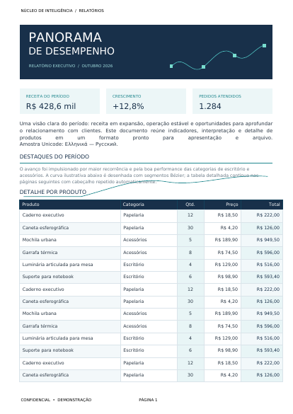
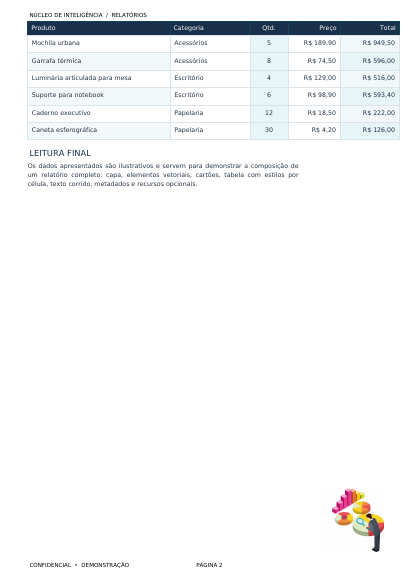

# PDFpkgen

Package Oracle PL/SQL para gerar documentos PDF 1.4 diretamente no banco, em memória, retornando o arquivo como `BLOB` temporário. A implementação monta os objetos PDF, os fluxos de páginas, recursos, referências cruzadas (`xref`) e trailer sem depender de um serviço externo de geração.

> **Status:** projeto PL/SQL em desenvolvimento. A compilação e a renderização devem ser verificadas no Oracle Database e em um leitor de PDF compatível com os recursos utilizados.

## Recursos

- Criação de documentos multipágina com formato A4, Letter ou Legal, orientação retrato/paisagem e dimensões personalizadas em pontos.
- Margens configuráveis em centímetros e paginação automática de linhas e parágrafos.
- Cabeçalhos e rodapés repetidos, com alinhamento e marcador `{PAGE}` para numeração de páginas.
- Texto com Helvetica regular, negrito, itálico e negrito-itálico; alinhamento à esquerda, centro, direita ou justificado.
- Quebra de texto, medição estimada de largura e altura de parágrafo.
- Tabelas com cabeçalho repetido na paginação, células com borda, preenchimento, padding, alinhamento horizontal/vertical, cor e negrito.
- Desenho vetorial: linhas, retângulos, caminhos, segmentos e curvas Bézier, com cores RGB.
- Inclusão de imagens JPEG RGB8 e PNG grayscale/RGB8 ou indexado, com suporte limitado a transparência binária `tRNS`. **PNG RGBA/grayscale+alpha e transparência parcial não são suportados.** A escala e o alinhamento vertical da imagem em relação à linha de texto podem ser configurados.
- Metadados do PDF: título, autor, assunto e palavras-chave.
- Fonte TrueType incorporada opcional para texto Unicode BMP, com mapa ToUnicode. A fonte deve ser fornecida pelo usuário e cobrir os caracteres usados; não há suporte a emojis, shaping complexo ou OTF-CFF/WOFF.
- Validação dos argumentos de dimensão, coordenada, cor, alinhamento, caminho vetorial e imagem, com erros PL/SQL descritivos.

## Requisitos

- Oracle Database com PL/SQL e acesso aos pacotes `DBMS_LOB`, `UTL_RAW` e `UTL_I18N`.
- Permissões necessárias para criar a package e utilizar esses pacotes.
- Opcionalmente, uma tabela de repositório com coluna `BLOB` e uma sequência para armazenar PDFs, fontes e imagens usados nos exemplos. Esses objetos são da aplicação e não são criados pelo projeto.

## Instalação

No schema desejado, execute os scripts nesta ordem:

1. [`src/pdfpkgen.pks`](src/pdfpkgen.pks) — specification da package.
2. [`src/pdfpkgen.pkb`](src/pdfpkgen.pkb) — body da package.

Verifique os erros de compilação do schema, por exemplo:

```sql
SELECT type, line, position, text
FROM user_errors
WHERE name = 'PDFPKGEN'
ORDER BY sequence;
```

## Uso básico

```sql
DECLARE
    l_pdf BLOB;
BEGIN
    pdfpkgen.set_page_size('A4', 'P');
    pdfpkgen.set_margins_cm(2, 2, 2, 2);
    pdfpkgen.set_metadata(
        p_title => 'Relatório de exemplo',
        p_author => 'Equipe de dados',
        p_subject => 'Demonstração da PDFpkgen',
        p_keywords => 'relatório, exemplo'
    );
    pdfpkgen.set_page_footer('Página {PAGE}', 9, FALSE, 'R');

    pdfpkgen.new_document;
    pdfpkgen.write_text(40, 780, 'Relatório de exemplo', 18, TRUE);
    pdfpkgen.write_paragraph(
        p_x => 40,
        p_y => 745,
        p_width => 515,
        p_text => 'A package gera o PDF em memória e o devolve como BLOB.',
        p_size => 11,
        p_align => 'J'
    );

    l_pdf := pdfpkgen.generate;

    -- Persista ou transmita l_pdf. Libere-o quando não for mais necessário.
    IF DBMS_LOB.ISTEMPORARY(l_pdf) = 1 THEN
        DBMS_LOB.FREETEMPORARY(l_pdf);
    END IF;
END;
/
```

As rotinas com coordenadas explícitas usam pontos PDF e não fazem paginação automática. `write_line`, `write_paragraph` e as linhas de tabela confirmadas com `next_row` podem avançar para novas páginas. A package mantém estado de sessão: gere um documento antes de iniciar outro e não componha documentos simultâneos na mesma sessão.

## Exemplo e PDF resultantes

Há um script de exemplo de uso, localizado em [`exemplo/`](exemplo/), o qual demonstra capa editorial, metadados, cartões, gráfico Bézier, tabela paginada, imagem e fonte opcionais. O exemplo pressupõe `repositorio_arquivo` e `repositorio_arquivo_seq`; ajuste nomes e registros de imagem/fonte para o seu schema. Há um PDF de demonstração já gerado em [`exemplo/`](exemplo/).

O PDF é um artefato de exemplo existente no projeto; não implica que o script possa ser executado sem preparar as tabelas, sequências e BLOBs indicados no próprio exemplo.

| PDF página 1                         | PDF página 2                         |
| ------------------------------------ | ------------------------------------ |
|  |  |


## Documentação técnica

A documentação de instalação, coordenadas, paginação, metadados, texto, tabelas, desenho, imagens, limitações e referência de todas as rotinas públicas está em [`doc/pdfpkgen-manual.md`](doc/pdfpkgen-manual.md).

## Desenvolvimento com IA orientada por humano

A construção da package foi conduzida pelo desenvolvedor, que forneceu os prompts e as orientações necessários para traduzir a especificação do formato PDF em funcionalidades PL/SQL. Durante o desenvolvimento, as funcionalidades foram avaliadas e ajustadas iterativamente para alcançar um resultado adequado ao propósito do projeto. A IA atuou como ferramenta de apoio nesse processo, sob orientação e revisão humana.

Foi utilizado o **GitHub Copilot Pro**, com o modelo **GPT-6 Luna**.

Não há neste repositório um registro verificável do consumo de créditos associado ao projeto. Por isso, não é possível informar uma quantidade sem especular; eventuais cotas e métricas dependem do histórico de uso da conta e do serviço.

## Referências

- ISO. **ISO 32000-1:2008 — Document management — Portable document format — Part 1: PDF 1.7.** Referência para estrutura, objetos, streams, fontes, imagens e dicionários do PDF.
- W3C. **Portable Network Graphics (PNG) Specification (Third Edition).** Referência para chunks, paletas, filtros e transparência PNG: <https://www.w3.org/TR/png-3/>.
- Oracle. **Database PL/SQL Language Reference** e documentação dos pacotes `DBMS_LOB`, `UTL_RAW` e `UTL_I18N`, para as APIs de linguagem e LOB utilizadas.

## Licença

A package PDFpkgen (arquivos de especificação e corpo em `src/pdfpkgen.pks` e `src/pdfpkgen.pkb`) é licenciada sob a **GNU General Public License v3.0 (GPLv3)**. Essa licença se aplica somente à package; não se estende automaticamente ao exemplo, à documentação, ao PDF de demonstração ou a outros arquivos deste repositório. Esses materiais e quaisquer fontes, imagens ou outros recursos de terceiros permanecem sujeitos às licenças e aos direitos aplicáveis a cada item.
